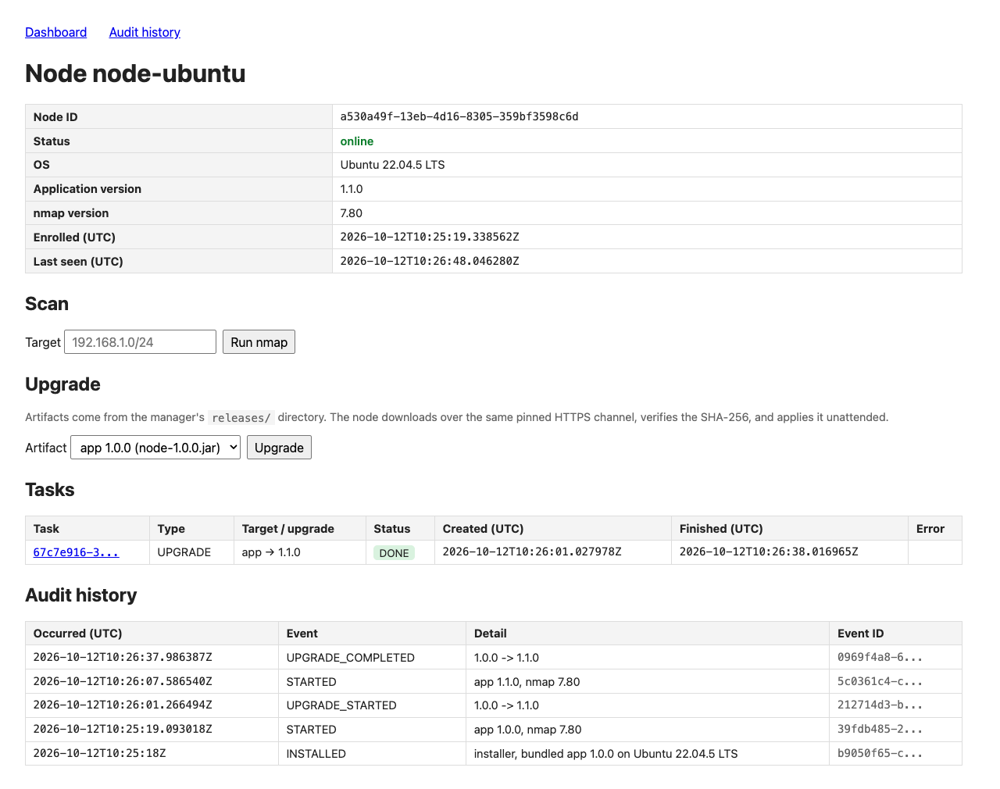
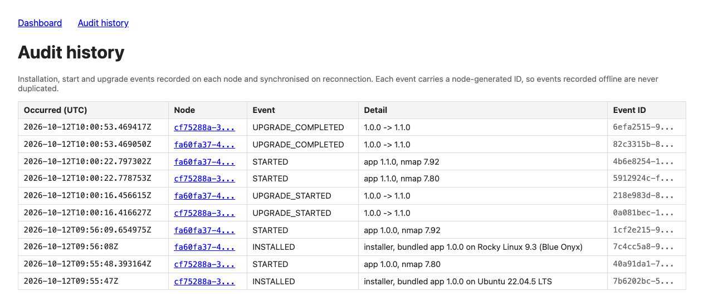

# Remote Scanning Node

A manager with a web dashboard, and Linux node agents that run real `nmap` scans and report back.
Nodes open every connection (HTTPS long-poll); the manager never contacts a node.

`manager/` Spring Boot API + Thymeleaf dashboard + H2 · `node/` the agent · `common/` the wire
protocol. Design and trade-offs: [plan.md](plan.md). AI usage: [AI_USAGE.md](AI_USAGE.md).

## Run the demo

Needs only **Docker** (the script offers to install it). Tested on macOS (Apple Silicon); port 8443
must be free.

```bash
./demo.sh          # build in Docker, start the manager + clean Ubuntu 22.04 and Rocky 9 hosts, install a node on each
./demo.sh local    # same, but the manager runs with your local JDK 21 + Maven
./demo.sh down     # stop and remove everything
```

Open <https://localhost:8443/> (accept the self-signed certificate). Within ~20 s:
`2 registered, 2 online`, Ubuntu with nmap 7.80, Rocky with nmap 7.92.

| Try | How | Expected |
|---|---|---|
| Scan | *New scan* → `127.0.0.1` on each node | both `DONE`, structured results + raw XML |
| Reinstall | run `./demo.sh` again | `REINSTALLED`, same node IDs |
| Reboot | `docker restart node-rocky` | back online with the same ID |
| App upgrade | node page → `node-1.1.0.jar` | 1.0.0 → 1.1.0; `UPGRADE_STARTED`, `UPGRADE_COMPLETED` |
| Logs | `docker exec node-ubuntu journalctl -u scanning-node -f` | heartbeat and task log |

### App upgrade 1.0.0 → 1.1.0

Click *Upgrade* on a node page, or run the same request from a terminal:

```bash
ID=$(docker exec node-ubuntu grep -oE '[0-9a-f-]{36}' /var/lib/scanning-node/identity.json | head -1)
curl -sk -d artifact=node-1.1.0.jar https://localhost:8443/nodes/$ID/upgrade   # queue the upgrade
docker exec node-ubuntu readlink /opt/scanning-node/current                      # ~40 s later: releases/1.1.0/node.jar
```

The node downloads the JAR, verifies its SHA-256, swaps it in and restarts itself; same node ID,
no manual step ([plan.md §6](plan.md)):



**Not demonstrated:** the nmap binary upgrade is implemented and unit-tested, but no newer nmap
package installs on Ubuntu 22.04 arm64 ([plan.md §6](plan.md)).

On a real host: copy `deploy/install.sh`, `deploy/node-start-with-rollback.sh` and
`releases/node-1.0.0.jar`, then `sudo ./install.sh --manager https://<manager>:8443 --token <token>`.
Validated on Ubuntu 22.04 and Rocky 9 (RHEL 9); Ubuntu 24.04 and RHEL 8 use the same path but are
not validated. Runs as root, because nmap upgrades install OS packages.

## Build and test

JDK 21+ and Maven 3.9+:

```bash
mvn package    # build + 46 tests
```

## Screenshots



