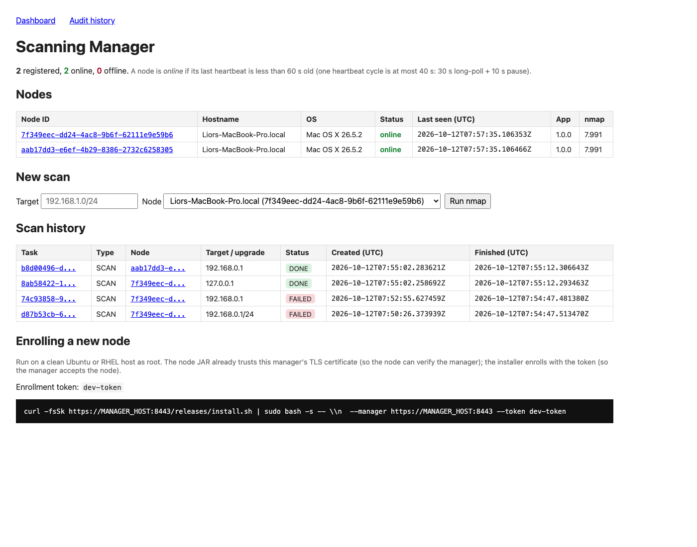
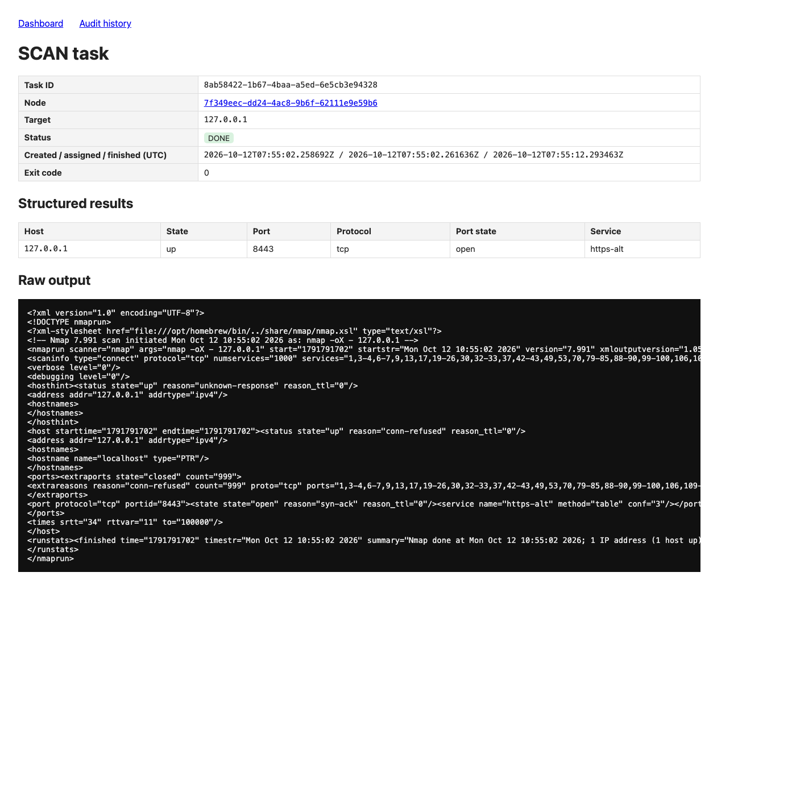

# Remote Scanning Node

A manager with a web dashboard, plus Linux node agents that run real `nmap` scans and report the
results back. Nodes open every connection (an HTTPS long-poll heartbeat); the manager never
contacts a node.

- `manager/`: Spring Boot manager, REST API for nodes, Thymeleaf dashboard, H2 database.
- `node/`: Spring Boot node agent; keeps its state in JSON files.
- `common/`: the wire protocol (`Protocol.java`).
- Design, decisions and recovery guarantees: [plan.md](plan.md). AI usage: [AI_USAGE.md](AI_USAGE.md).

## Prerequisites

Tested on macOS (Apple Silicon) with Docker Desktop. Linux and Windows (WSL2) are expected to work
but untested. Port 8443 must be free.

| How you run it | You need |
|---|---|
| `./demo.sh` (everything in Docker, **recommended**) | **Docker only.** The script offers to install it if missing. |
| `./demo.sh local` (manager runs locally, hosts in Docker) | Docker, JDK 21+, Maven 3.9+ |
| Build and unit tests | JDK 21+, Maven 3.9+ |

| OS | Docker | JDK 21 + Maven |
|---|---|---|
| macOS | `brew install --cask docker`, then start Docker Desktop | `brew install openjdk@21 maven` |
| Ubuntu / Debian | `curl -fsSL https://get.docker.com \| sudo sh` | `sudo apt install openjdk-21-jdk maven` |
| RHEL / Rocky / Alma | `curl -fsSL https://get.docker.com \| sudo sh` | `sudo dnf install java-21-openjdk-devel maven` |
| Windows | `winget install Docker.DockerDesktop` (WSL2 backend); run the scripts inside WSL2 Ubuntu | inside WSL2: as Ubuntu |

## Run the demo

```bash
./demo.sh            # or: ./demo.sh local   to run the manager with your local java
```

What it does, and what to expect:

1. Builds everything from source inside Docker (first run: a few minutes for Maven downloads).
2. Starts the **manager** container (dashboard and node API on port 8443) and two clean Linux
   hosts, **Ubuntu 22.04** and **Rocky Linux 9** (RHEL 9 compatible). The hosts run systemd and
   publish no ports: nothing can connect into a node.
3. Runs the real installer on each host. It installs OpenJDK 21 and nmap from the distro repos,
   sets up the systemd service and ends with `INSTALLED: scanning-node (bundled 1.0.0, ...)`.
4. Open <https://localhost:8443/> and accept the self-signed certificate warning. Within ~20 s:
   `2 registered, 2 online`, Ubuntu with nmap 7.80 and Rocky with nmap 7.92.

Stop everything with `./demo.sh down` (the next run starts from clean hosts).

To install a node on a real host, copy the bundle (`deploy/install.sh`,
`deploy/node-start-with-rollback.sh`, `releases/node-1.0.0.jar`) and run
`sudo ./install.sh --manager https://<manager>:8443 --token <token>`.

### What to try

| Check | Command | Expected |
|---|---|---|
| Scan | dashboard → *New scan* → `127.0.0.1` on each node | both `DONE` with results and raw XML |
| Reinstall keeps identity | run `./demo.sh` again | `REINSTALLED`, same node IDs, audit shows `REINSTALLED` |
| Reboot | `docker restart node-rocky` | service starts on boot, same node ID, back online |
| App upgrade | node page → upgrade to `node-1.1.0.jar` | app 1.0.0 → 1.1.0; audit `UPGRADE_STARTED`, `UPGRADE_COMPLETED` |
| nmap upgrade | put a newer nmap `.deb`/`.rpm` in `releases/`; node page → upgrade | **not demonstrated\*** |
| Logs | `docker exec node-ubuntu journalctl -u scanning-node -f` | heartbeat and task log |

\* The nmap upgrade is implemented and unit-tested but not demonstrated: no newer nmap package
installs on Ubuntu 22.04 arm64 (see [plan.md](plan.md) §6).

### Supported OS versions

| OS | Status |
|---|---|
| Ubuntu 22.04 LTS | Validated (Docker, systemd) |
| RHEL 9 | Validated on Rocky Linux 9 (binary compatible) |
| Ubuntu 24.04, RHEL 8 / Alma / Rocky 8 | Same installer path; not validated (installer warns) |

The installer needs root and outbound access to the distro repositories only (OpenJDK 21 and nmap
come from them). The service runs as root because nmap upgrades install OS packages.

## Build, test, and developer shortcut (no Docker)

**Developer shortcut only:** runs a node directly with `java -jar` on your machine, with no
installer and no systemd, so no start on boot and no upgrades. The real deployment is `./demo.sh`
(nodes on clean hosts via `install.sh`). The screenshots below were taken this way.

```bash
mvn package                                                              # build + all tests
SCANNING_ENROLLMENT_TOKEN=dev-token java -jar manager/target/manager-1.0.0.jar
SCANNING_ENROLLMENT_TOKEN=dev-token SCANNING_STATE_DIR=$PWD/local/node1 SCANNING_APP_DIR=$PWD/local/node1 \
  java -jar node/target/node-1.0.0.jar     # second terminal; needs nmap installed locally
```

Expected: `BUILD SUCCESS`, then the node logs `Enrolled as node <id>` and is online in the
dashboard. Reset: `rm -rf data local`.

## Dashboard

Two nodes enrolled and online, each running a quick scan at the same time (`127.0.0.1` and
`192.168.0.1`, both `DONE` within about 10 s):



- The top line shows registered/online counts and how "online" is defined.
- Each node row shows identity, status, last seen, app version and the actual nmap version.
- Click a task ID in *Scan history* to see its structured results and raw nmap output.

## Scan result

The `127.0.0.1` task: status, timestamps, exit code, the parsed results (the manager's own
port 8443 is open) and the raw nmap XML output:


